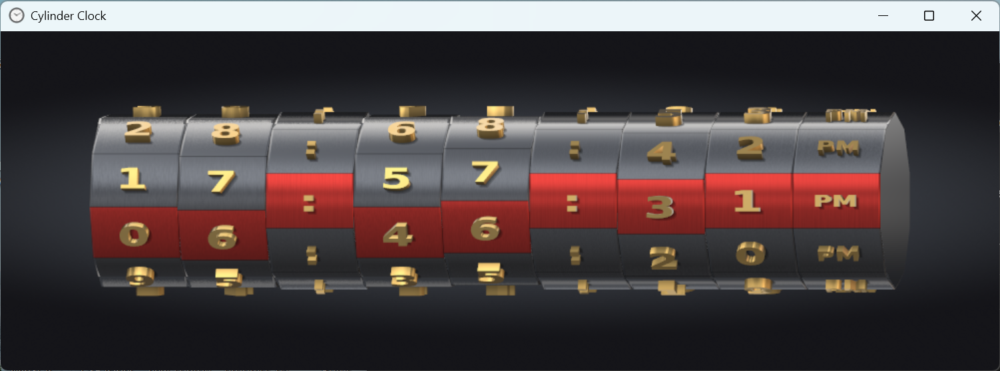

This project started decades ago on Planet Source Code at (now a dead link): http://www.Planet-Source-Code.com/vb/scripts/ShowCode.asp?txtCodeId=6348&lngWId=3  It may have also been found on the Nehe OpenGL Tutorials Site

I have removed its dependencies on glaux, fixed a logic error for 12 am and 12 pm and updated the graphics to a much higher resolution for better appearance of the numbers. I've also added shading to the top and bottom of the clock to produce a more 3D appearance and eliminated the font textures in favor of true 3D vector fonts.

This is a flip clock where the numbers rotate around a cylinder to display the correct time, much like a bicycle cylinder combination lock.

Ver. 2.0

Per-pixel shading: polished brass digits that reflect a studio room, brushed-metal drums lit as true cylinders, soft shadows under the digits and anti-aliased edges. It uses GLSL shaders fetched from the graphics driver at startup (no extra libraries); on a driver without them the clock draws as in 1.6. Press F to switch between the two looks.

Ver. 1.6

Ver. 1.4

Ver. 1.2

To build, open the Visual Studio Solution file and select "Build".
